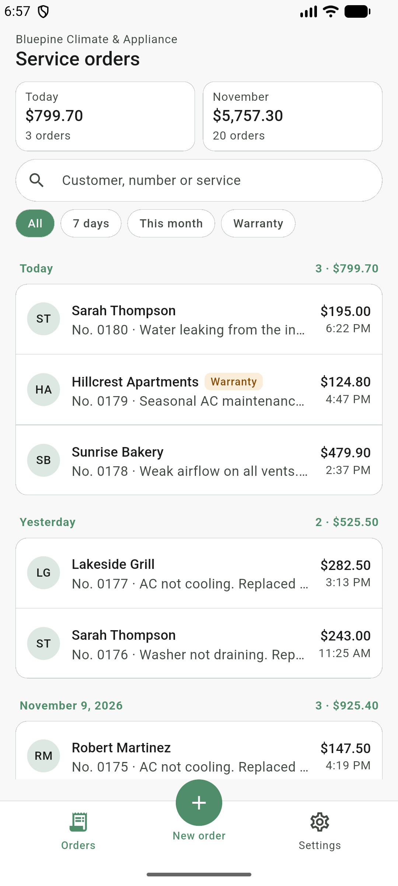
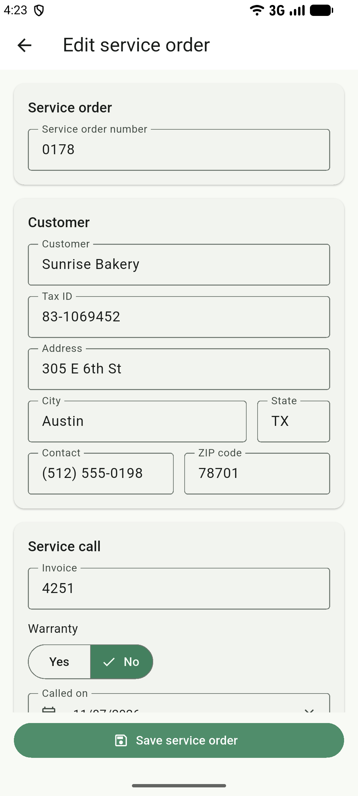
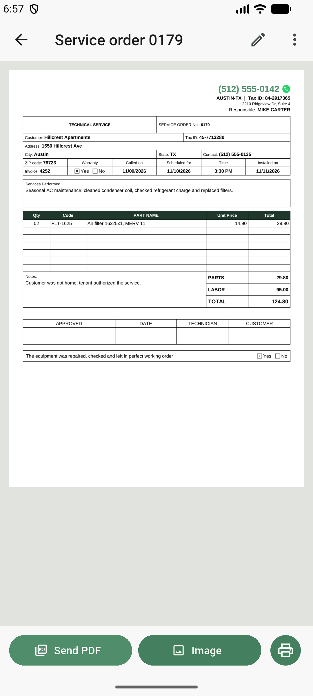
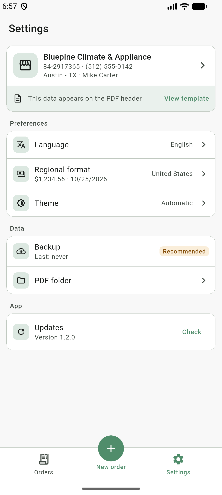

<p align="center">
  
</p>

<h1 align="center">Service Order App</h1>

<p align="center">
  Offline-first, white-label Android app to create service orders and share them as PDF or image.
</p>

<p align="center">
  <a href="https://github.com/WandersoNoleto/service-order-app/releases/latest"></a>
  <a href="https://github.com/WandersoNoleto/service-order-app/releases"></a>
  
  
  
  
</p>

<p align="center">
  <a href="#features">Features</a> ·
  <a href="#getting-started">Getting started</a> ·
  <a href="#white-label-adding-a-client">White-label</a> ·
  <a href="#releases-and-updates">Releases</a>
</p>

<p align="center">
  
  
  
  
</p>

## Features

- **Service orders**: customer, service call, parts with live totals and notes, stored on the phone
  (SQLite). No account, no server, works offline.
- **History** grouped by day, with totals for today and the month, search by customer or number and
  quick filters (7 days, this month).
- **A4 PDF** following a paper template; the parts table continues on the next page when needed.
- **Share** as PDF or image (WhatsApp), or print.
- **PDF folder**: every saved order also gets its PDF in `Documents/<app name>` on the phone
  (Android 10+), which stays there if the app is uninstalled.
- **Backup and restore**: orders, settings and logo in one `.zip`, sent to Drive, WhatsApp or e-mail
  or saved on the phone. Restoring replaces everything and can be undone right after.
- **Company data and logo** editable in the app; only what is filled in is printed on the header.
- **Portuguese and English**, following the phone or chosen in the app. Regional format (currency,
  dates, times) is a separate setting, so English with Brazilian reais works, and vice versa.
- **Light and dark themes**, following the phone or chosen in the app.
- **In-app updates** from GitHub Releases.
- **White-label**: each client gets its own app id, name, colors, logo, icon and splash.

> [!NOTE]
> Everything stays on the device. Uninstalling the app deletes the service orders, so keep a
> backup outside the app (Settings → Backup).

## Getting started

Requirements: Flutter 3.47+ and an Android device or emulator.

```bash
git clone https://github.com/WandersoNoleto/service-order-app.git
cd service-order-app
flutter pub get
flutter run --flavor standard --dart-define-from-file=clients/default/config.json
```

`standard` is the generic app: green theme, no logo and an example company that follows the app
language. Replace it in **Settings**, on the company card at the top.

Run the tests with:

```bash
flutter test
```

## White-label: adding a client

Client files never live in this repository. They go to `clients/private/<client>/`, a separate
private repository cloned into that folder (git-ignored here). Example for a client called `acme`:

1. **Config**: `clients/private/acme/config.json`, same keys as
   [`clients/default/config.json`](clients/default/config.json):
   `APP_CHANNEL` (`"acme"`), company data, `BRAND_COLOR` (`AARRGGBB`) and `LOGO_ASSET`
   (`"clients/private/acme/branding/logo.png"`, or `""` for no logo). Leave `SAMPLE_COMPANY` out.
2. **Logo** (optional): `clients/private/acme/branding/logo.png`, plus the asset entry in
   `pubspec.yaml`:
   ```yaml
   - path: clients/private/acme/branding/
     flavors: [acme]
   ```
3. **Flavor**: add it to `android/app/build.gradle.kts` (see the commented example there), with
   `applicationIdSuffix = ".acme"`.
4. **Icon and splash** (optional): SVG/PNG sources and the generator configs
   (`flutter_launcher_icons-acme.yaml`, `flutter_native_splash-acme.yaml`) in
   `clients/private/acme/icon/`, symlinked into the project root. Generate with:
   ```bash
   dart run flutter_launcher_icons
   dart run flutter_native_splash:create --flavor acme
   ```
   Generated files go to `android/app/src/acme/` (git-ignored). Without them the client app uses the
   generic icon and splash. See [`assets/icon/README.md`](assets/icon/README.md).
5. **Run**:
   ```bash
   flutter run --flavor acme --dart-define-from-file=clients/private/acme/config.json
   ```

## Releases and updates

The version lives in `pubspec.yaml` (`x.y.z+<versionCode>`). Build signed APKs with:

```bash
tool/build_release.sh standard      # tag vX.Y.Z
tool/build_release.sh acme 1        # tag vX.Y.Z-acme.1
```

Publish the APK as a GitHub release with the printed tag. Each app only looks at the tags of its own
channel, so the generic app and each client update independently. Release signing reads
`android/key.properties` (see `android/key.properties.example`).

> [!IMPORTANT]
> Every release of an app must be signed with the same keystore, or Android refuses the update.

## Project structure

```
lib/
├── app/            # app shell, navigation, theme, dependency wiring
├── core/           # config, database, formatting, preferences, storage
├── features/
│   ├── service_order/  # form and SQLite repository
│   ├── history/        # list grouped by day, summary, search and filters
│   ├── backup/         # .zip export and restore
│   ├── document/       # PDF layout, preview, share, print and the PDF folder
│   ├── settings/       # company data, logo, language, format and theme
│   └── update/         # GitHub Releases check and install
└── l10n/           # Portuguese (template) and English strings
```

## Built with

[Flutter](https://flutter.dev) · [sqflite](https://pub.dev/packages/sqflite) ·
[pdf](https://pub.dev/packages/pdf) · [printing](https://pub.dev/packages/printing) ·
[share_plus](https://pub.dev/packages/share_plus) · [ota_update](https://pub.dev/packages/ota_update)
